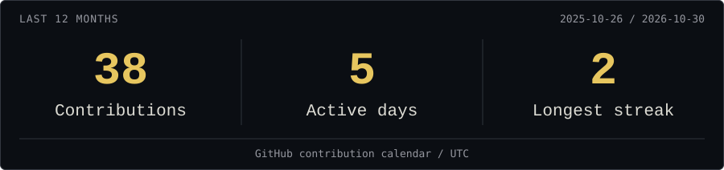
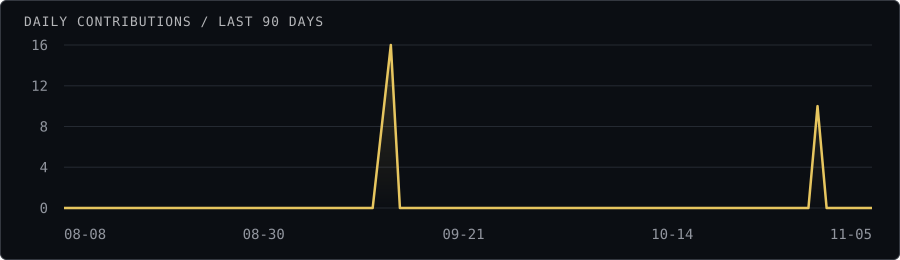
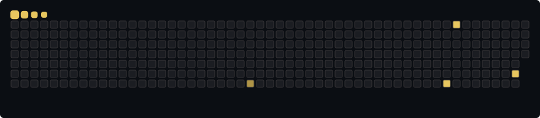

  

  
  

<h2 align="center">About me</h2>

I'm **tandem**. I've been learning programming for **four years**, working with **C++ and Python** and studying **algorithms and computer networks**.

My current interests include **high-frequency trading (HFT)** and **low-latency systems** — a direction I'd like to pursue through further study and future software engineering work.

<h2 align="center">Technologies</h2>

  
  
  
  
  

Exploring HFT and low-latency systems.

<h2 align="center">Statistics</h2>

  <picture>
    <source media="(max-width: 600px)" srcset="https://raw.githubusercontent.com/tandemexe/tandemexe/output/stats-mobile.svg" />
    
  </picture>

<h2 align="center">Contribution history</h2>

  <picture>
    <source media="(max-width: 600px)" srcset="https://raw.githubusercontent.com/tandemexe/tandemexe/output/activity-chart-mobile.svg" />
    
  </picture>

  

Activity updates daily. All timestamps are UTC.

